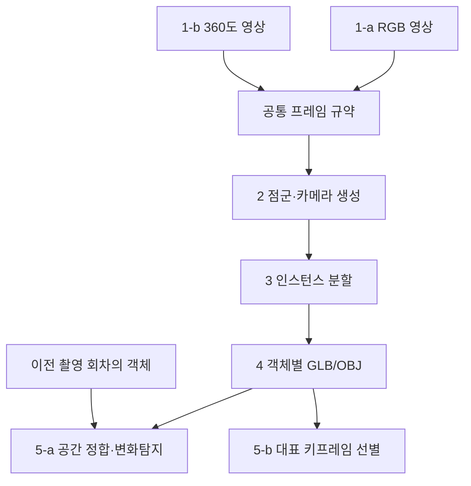

# SpaceWatch3D

## Task 5a · 모델 비교 진행 중 (2026-10-26)

**Task 5a는 현재 모델 비교를 진행 중입니다.** 현재 화면은 **서로 다른 Dorm2·Dorm3 가우시안 맵**에서 기존 메쉬 정합·관측검증 후보와 새 SimSaC 후보를 비교합니다. 기존 정합·판정은 메쉬에 유지하고, SimSaC는 두 3DGS 맵을 같은 정합 카메라로 렌더링해 다시 추론했습니다. 전 맵의 후보 박스를 누르면 해당 3D 영역에 후 가우시안이 반투명하게 겹칩니다. 실제 Gaussian 386,826 / 369,446개 전체를 사용하며, 원본 영상·체크포인트 해시가 서로 다른 두 맵임을 확인했습니다. 이전 RGB·ViewDelta·SceneDiff 비교는 보관했습니다.

- **현재 입력 경로:** 기존 방식은 메쉬·객체 관측 근거로 판정한 후보를 가우시안 맵에 표시합니다. SimSaC는 전·후 가우시안 맵을 같은 위치·방향에서 렌더링한 RGB를 비교하고, 렌더 깊이로 후보를 3D에 연결합니다. 가우시안 파라미터를 직접 비교하는 모델은 아직 연결하지 않았습니다.
- **사람 제외 기본 적용:** 새 3DGS 렌더의 사람 분할·검출 박스와 양쪽 관측 가능 영역을 확인합니다. 사람 제외 토글을 지원합니다. 현재 기존 후보 2묶음 / SimSaC 5영역이며 정확도 수치가 아닙니다.
- [진행 상황·실행 방법](docs/task5a-model-comparison-20261025.md)
- [가우시안 직접 입력 변화탐지 조사·코드 공개 상태](docs/gaussian-direct-change-detection-research-20261025.md)
- [Task 5a README](src/spacewatch3d/tasks/task_5a_change_detection/README.md)
- [비교 화면 파일](src/spacewatch3d/tasks/task_5a_change_detection/assets/panorama-change-20261025/gaussian-map-comparison-20261025/index.html) · [실제 화면 캡처](src/spacewatch3d/tasks/task_5a_change_detection/assets/panorama-change-20261025/gaussian-map-comparison-20261025/viewer-gaussian-ghost.png)

전체 Gaussian PLY와 원본 확률 NPZ는 별도 입력으로 보존합니다. 실행 방법의 다운로드 안내를 확인해 주세요. 현재는 변화 후보와 입력 방식의 차이를 확인하는 실험 단계입니다. 서로 다른 층의 파일럿이며, 공통 Task 5a backend 통합과 정확도 평가는 진행 과제로 남아 있습니다.

## 최근 변경 · 2026-10-14

- **키프레임 이동 효과:** 바닥 화살표·방향키·키프레임 미리보기로 이동할 때 화면을 이동 방향으로 살짝 확대하고 도착 화면으로 약 0.42초 동안 부드럽게 전환합니다. 중간 영상을 재생하지 않으며 이동 후에는 정지 상태를 유지합니다. 일반 재생·타임라인 탐색은 기존 동작을 유지합니다.
- 동작 줄이기 설정, 중복 이동 차단, 전환 취소와 영상 디코딩 지연·오류 처리를 포함합니다. [사용법과 검증 내역](apps/autotour360/CHANGELOG.md)

## 최근 변경 · 2026-10-12

- **변화 종류 라벨:** 점군 위와 영역 목록에 제거 후보·추가 후보를 표시합니다. 객체 이동 거리는 별도 항목으로 표시하고, 대응 정보가 없는 현재 데이터에서는 산정 불가로 구분합니다. 표면 간 최근접 거리를 객체 이동 거리로 해석하지 않습니다.

- **실제 전후 3D 변화 근거 데모:** MultiChange3D Open Space의 실제 RGB-D 재촬영 쌍(원본 총 6,866,303점)을 사용합니다. 기존 뷰어 상단 **3D 변화 근거**에서 전후 점군을 같은 시점으로 비교하고 변화 영역 5개를 선택할 수 있습니다.
- 공식 변화 라벨을 입력으로 받아 영역별 원본 점 번호를 보존하고, 공간 표본 14,340점에서 반대 회차 전체 점군까지 최근접 거리를 측정했습니다. 표본 통계, 원본 포인트·거리 다운로드, 추가 검증이 필요한 항목을 표시합니다.
- 객체 ID·깊이·원본 영상이 없는 데이터이므로 동일 객체의 이동·가림·실제 빈 공간·전후 키프레임은 미검증 상태입니다. 탐지 모델 성능이나 전체 파이프라인 완성을 뜻하지 않습니다.

실행·측정 범위·출처: [실제 데이터 근거 데모](docs/change-evidence-demo.md) · [데이터 조사](docs/change-evidence-data-sources.md)

## 최근 변경 · 2026-10-10

- **투어 이동 지점 자동 선별:** 촬영 동선의 시작·끝과 꺾임을 유지하고, 중복·정지 구간을 줄여 이동 지점을 고릅니다. 영상 선명도·밝기를 비교하며, 선택 수 조절·미리보기·바닥 화살표 이동·JSON 저장을 지원합니다. 실제 360도 영상에서 관측 지점 121개를 보통 설정으로 22개 선별했습니다.
- **동선 지도 위치 이동:** 지도 제목이나 지도 안을 잡아 끌어 화면을 가리지 않는 곳에 둘 수 있습니다. 경로를 짧게 클릭하면 영상 시각으로 이동하며, 끌면 지도 위치만 옮깁니다. 위치를 저장하고 화면 크기에 맞춰 유지합니다. 제목을 두 번 누르면 원래 위치로 돌아갑니다.
- 영상 속 **바닥 화살표**와 GitHub 원본의 **촬영 경로 설정 창**을 유지했습니다. 지도 옆 별도 방향 버튼과 영상 위 경로 선·범례는 제거했습니다.
- 이번 선별은 **투어 이동 지점**용입니다. 객체별 대표 프레임을 고르는 파이프라인 **Task 5b**는 별도 작업입니다.

사용법과 검증 내역: [AUTO TOUR 360 README](apps/autotour360/README.md) · [변경 기록](apps/autotour360/CHANGELOG.md)

## 프로젝트 소개

영상 기반 객체별 3D 모델 생성 및 시계열 공간 변화 모니터링 프로젝트입니다.
첨부 파이프라인(2026-09-27)을 기준으로 **task별 병렬 개발을 시작할 수 있는 공통 기반**을 구성했습니다.

**현재 상태:** task 폴더, 입출력 규약, 합성 fixture, 검증 CLI가 준비되어 있습니다.
실제 영상 처리·LingBot-Map·MV3DIS·메시 생성·정합·변화탐지·키프레임 선별 backend는 각 task에서 구현합니다.
`run`은 backend 연결 전까지 미구현 오류를 반환합니다. fixture 검증 통과는 모델 성능이나 전체 파이프라인 완성을 의미하지 않습니다.

**360° 가상투어 앱:** [AUTO TOUR 360](apps/autotour360/README.md)은 별도로 실행할 수 있습니다. 저장소 루트에서 `./apps/autotour360/start.sh`를 실행하면 영상 입력·촬영 경로 추정·경로 클릭 이동을 사용할 수 있습니다. 코드·데이터 구성과 분석 한계는 [가상투어 문서](docs/virtual-tour.md)에 정리했습니다.


spacewatch3d/
├── README.md                  # 프로젝트 소개와 시작 방법
├── CONTRIBUTING.md            # 브랜치·PR 등 협업 규칙
├── pyproject.toml             # Python 패키지 설정과 공통 의존성
├── .gitignore                 # Git에 올리지 않을 파일 지정
│
├── src/
│   └── spacewatch3d/           # 프로젝트의 Python 코드
│       ├── __init__.py
│       ├── __main__.py         # python -m spacewatch3d 진입점
│       ├── cli.py              # 명령어 처리와 작업 실행
│       ├── task_api.py         # 모든 작업이 공유하는 입력 형식
│       ├── registry.py         # 작업 번호·모듈·입출력 연결표
│       ├── contracts.py        # 결과 파일의 규칙·참조 관계 검사
│       ├── schemas/
│       │   └── artifact.schema.json  # JSON 데이터 형식 정의
│       └── tasks/             # 단계별 알고리즘 구현 위치
│
├── apps/
│   └── autotour360/           # 독립 실행 360도 가상투어 앱
│
├── examples/
│   └── fixtures/              # 개발·검증용 합성 예제
│       ├── before/            # 이전 촬영 회차 예제
│       ├── after/             # 이후 촬영 회차 예제
│       ├── panorama/          # 360도 영상 예제
│       └── changes.json       # 변화 결과 예제
│
├── tests/                     # 공통 검증 테스트
├── docs/                      # 설계 문서·작업표·발표자료
├── .github/                   # 자동 검사와 Issue·PR 양식
│
├── data/                      # 실제 입력 영상·데이터셋
├── outputs/                   # 실행 결과
├── weights/                   # AI 모델 가중치
└── third_party/               # 외부 모델 소스코드

참고해서 파일 정리할 것!!!!!!

## Task별 작업 위치

| 그림 번호 | 담당 범위 | 개발 폴더 | 입력 → 출력 |
|---|---|---|---|
| 1-a | RGB 영상 입력·프레임 추출 | [task_1a_rgb_input](src/spacewatch3d/tasks/task_1a_rgb_input/) | 일반 영상 → 프레임·출처 정보 |
| 1-b | 360° 영상의 perspective view 변환 | [task_1b_360_input](src/spacewatch3d/tasks/task_1b_360_input/) | 360° 영상 → 프레임·가상 카메라 정보 |
| 2 | 포인트클라우드 생성, LingBot-Map adapter | [task_2_reconstruction](src/spacewatch3d/tasks/task_2_reconstruction/) | 프레임 → XYZRGB·카메라·깊이 |
| 3 | 3D 인스턴스 분할, MV3DIS adapter | [task_3_instance_segmentation](src/spacewatch3d/tasks/task_3_instance_segmentation/) | 재구성 결과 → 점별 객체 ID·객체 메타데이터 |
| 4 | 객체별 메시·색상·텍스처 저장 | [task_4_object_export](src/spacewatch3d/tasks/task_4_object_export/) | 인스턴스 → GLB/OBJ·객체 메타데이터 |
| 5-a | 회차 간 **공간 정합 + 객체 대응 + 변화탐지** | [task_5a_change_detection](src/spacewatch3d/tasks/task_5a_change_detection/) | 두 회차의 객체 → 정합 변환·변화 결과 |
| 5-b | 객체별 대표 키프레임 **선별** | [task_5b_keyframes](src/spacewatch3d/tasks/task_5b_keyframes/) | 객체·관측 정보 → 원본 프레임·시각 |

각 폴더에 `README.md`, `pipeline.py`, `config.example.json`, `requirements.txt`가 있습니다.
사람별 담당 배정은 아직 지정하지 않았습니다. 같은 사람이 관련 task를 함께 맡아도 폴더와 출력 규약은 유지합니다.




실제 데이터 처리는 이 의존 순서가 필요합니다. **개발은 제공된 task별 입력 fixture로 동시에 진행**합니다.
5-a와 5-b는 서로의 구현을 기다릴 필요가 없습니다. 각 manifest는 상위 결과를 참조하므로 프레임·카메라 정보도 추적할 수 있습니다.

## 5분 시작

Python 3.10+가 필요합니다. 아래 명령은 저장소 루트에서 실행합니다.

```bash
git clone --depth 1 --single-branch --branch main https://github.com/choonpal/spacewatch3d.git
cd spacewatch3d
python -m venv .venv
```

Linux/macOS: `source .venv/bin/activate` · Windows PowerShell: `.venv\Scripts\Activate.ps1`

```bash
python -m pip install -e .
python -m spacewatch3d tasks
python -m spacewatch3d check-fixtures
python -m unittest discover -s tests -v
```

공통 환경은 jsonschema만 설치하며 GPU가 필요하지 않습니다. 모델별 의존성은 해당 task 환경에 설치합니다.
작은 합성 영상은 이미 포함되어 있어 검증에 FFmpeg 설치도 필요하지 않습니다.

## 내 task만 시작하기

예를 들어 Task 3 담당자는 다음과 같이 시작합니다.

```bash
git switch -c task/3-instance-segmentation/mv3dis-adapter
python -m spacewatch3d check-fixtures --task 3
```

1. `src/spacewatch3d/tasks/task_3_instance_segmentation/README.md`를 읽습니다.
2. 입력 예제 `examples/fixtures/before/reconstruction.json`과 출력 예제 `instances.json`을 확인합니다.
3. 해당 폴더의 `pipeline.py`에 `run(request) -> Path`를 구현합니다.
4. 출력 manifest를 검증하고 task 전용 테스트와 재현 명령을 추가합니다.
5. 작업 브랜치를 push하고 `main` 대상 PR로 통합합니다.

```bash
python -m spacewatch3d validate outputs/my-run/instances.json --check-files
git add src/spacewatch3d/tasks/task_3_instance_segmentation tests/task_3_instance_segmentation
git commit -m "feat(task-3): add MV3DIS adapter"
git push -u origin task/3-instance-segmentation/mv3dis-adapter
```

팀원의 기존 작업물을 그대로 덮어쓰지 않도록 [협업 절차](CONTRIBUTING.md)를 따릅니다.
개별 GitHub issue나 담당자 알림은 자동 생성하지 않았습니다. [task 작업표](docs/task-board.md)에서 분담과 완료 기준을 확인합니다.

## 공통 영역과 데이터

| 경로 | 용도 |
|---|---|
| `src/spacewatch3d/tasks/` | task별 구현·설정·의존성 설명 |
| `src/spacewatch3d/task_api.py` | 모든 task의 공통 함수 입력 |
| `src/spacewatch3d/registry.py` | task 입력 이름·출력 kind·fixture 매핑 |
| `src/spacewatch3d/schemas/` | 기계 검증용 JSON Schema 0.1.0 |
| [docs/contracts.md](docs/contracts.md) | 좌표·스케일·ID·파일 경로·단계별 규약 |
| [examples/fixtures/](examples/fixtures/) | 작은 합성 입력·출력: 앞 task 없이 개발 시작 |
| `tests/` | 공통 규약 검증 및 task별 테스트 위치 |
| `data/`, `outputs/`, `weights/`, `third_party/` | 실제 데이터·실행 결과·가중치·외부 코드, Git 제외 |
| `.github/` | PR·task issue 양식과 CPU 규약 검사 CI |

공통 규약을 변경할 때는 schema·문서·fixture·테스트를 함께 갱신하고 영향을 받는 task 담당자와 합의합니다.
점군을 곧바로 메시로 간주하거나, 분할 모델이 의미 클래스까지 반드시 제공한다고 가정하지 않습니다.

## 기존 작업과 기록

- [이전 main README 원문](docs/history/README-before-task-layout.md): COLMAP/OpenMVS 실험 기록. 원문 내 산출물 경로는 당시 작업 환경 기준입니다.
- 기존 `docs/`의 수행계획서·발표자료는 유지했습니다. 현재 task 구분과 입출력은 이 README 및 `docs/contracts.md`를 기준으로 합니다.
- `kdj`, `lth`, `gwanwoo3849-for-commit`, `wooh594-for-commit`, `library-cleanup` 브랜치와 기존 PR은 그대로 유지합니다.
- 기존 코드를 가져오는 위치와 절차: [기존 브랜치 이관 가이드](docs/migration.md).

분석 파이프라인은 위 task 구성을 기준으로 개발합니다. 가상투어 앱은 `apps/autotour360/`에서 독립적으로 실행하며, 기존 웹 초안은 별도 브랜치에 보존되어 있습니다.
