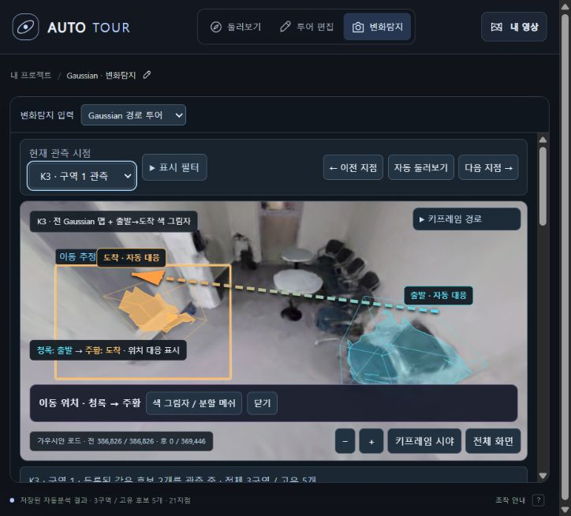

# AUTO TOUR 360 변경 기록

## 2026-10-26 · Gaussian 경로 변화탐지 연결

- 변화탐지 모드에 기존 네이티브 Gaussian 경로 렌더러를 연결했다. 21개 키프레임·저장 경로·현재 시야의 후보 박스·출발→도착 색 그림자와 구역별 고유 이벤트를 유지한다.
- 같은 변화는 여러 시점에서도 같은 ID로 유지한다. 현재 처리는 저장된 자동 분석을 표시하며 시점마다 새 추론을 하지 않는다. 전후 촬영 경로 차이와 공통 관측 범위의 제약을 도움말·문서에 명시했다.
- `--gaussian-change-dir`로 공개 산출물을 연결한다. 모델 누락 안내, 허용된 파일만 제공, PLY Range 요청, 같은 출처의 렌더러 메시지 검증, 모드 전환 시 렌더 중단·재개를 지원한다. 기존 Dorm·Rescan 입력도 유지한다.

검증: 앱 Node 78개 통과, Python 25개 중 22개 통과·환경 조건 3개 건너뜀. 모델 비교 회귀 Python 47개·Node 15개 통과. 실제 브라우저에서 K1→K3 경로 이동, 동일 후보 ID 유지, R12 출발→도착 표시, 일반 둘러보기 복귀 후 시점·선택 유지와 도움말을 확인했다.

## 2026-10-14 · 키프레임 이동 효과

- 바닥 화살표·방향키·키프레임 미리보기 이동에 이동 방향을 기준으로 한 가벼운 확대와 약 0.42초의 겹침 전환을 추가했다. 이전 화면을 고정하고 도착 프레임이 디코딩된 다음 전환하므로 중간 영상 구간은 재생하지 않는다.
- 도착 후에는 영상을 정지한 상태로 유지하고 기존 시야 보정과 확대 수준을 유지한다. 일반 영상 재생·타임라인 탐색·장면 열기에는 효과를 적용하지 않는다.
- 중복 이동을 차단하고, 드래그·휠·타임라인·장면 변경·그래픽 연결 끊김·백그라운드 전환에서 효과를 취소한다. 디코딩 지연·오류 시 화면과 조작 상태를 정리한다. 시스템의 동작 줄이기 설정을 따른다.

검증: Node 테스트 39개·Python 앱 테스트 14개와 JavaScript 구문 검사 통과. 실제 `R0010004.MP4`의 키프레임 22개를 사용해 미리보기·방향키·바닥 화살표 전환, 출발 화면 캡처, 0.42초 겹침 전환, 도착 후 정지와 시각 유지, 일반 재생·타임라인 동작, 전환 중 수동 탐색 취소, 동작 줄이기 설정과 모바일 화면을 확인했다.

## 2026-10-12 · 실제 전후 점군의 변화 근거

- 공식 MultiChange3D Open Space RGB-D의 실제 재촬영 pair_01(원본 총 6,866,303점, 130.46MB)을 다운로드하고 원본 SHA-256을 기록했다. 다운로드 스크립트와 근거 생성·원본 대조 도구를 추가했다.
- 공식 변화 라벨에서 연결된 변화 영역 5개를 묶고, 영역의 전체 원본 점 번호와 측정 표본 14,340개의 원본·상대 최근접 점 번호·거리를 저장했다. 표본은 반대 회차 전체 원본 점군과 비교하며, 통계 범위를 명시한다.
- 기존 서버와 상단 링크에서 전후 점군 비교 페이지를 제공한다. 영역 선택, 같은 좌표와 시점으로 보기, 원본 색상 전환, 회전·확대, 원본 포인트와 근거 파일 다운로드를 지원한다.
- 동일 객체 대응·가림·빈 공간·전후 키프레임에 필요한 객체 ID·깊이·카메라·영상이 없어 추가 검증 상태로 표시한다. 공식 라벨을 입력으로 사용하므로 탐지 모델 성능 평가가 아니다.

검증: 근거 원본 대조 14,340건, Python 근거 테스트 5개·기존 앱 테스트 14개, Node 투어 테스트 30개 통과. 실제 브라우저에서 전후 점군 렌더링·영역 1/5 선택·기하 차이와 겹침 상태·원본 점 번호·색상 전환·위에서 보기와 시점 동기화를 확인했다.

## 2026-10-10 · 동선 지도 위치 이동 및 README 변경 요약

- 저장소 루트와 앱 README 맨 위에 최근 뷰어 변경 내용을 정리했다.
- 동선 지도 제목과 지도 안을 드래그해 위치를 옮긴다. 짧게 경로를 클릭하는 영상 이동과 드래그를 구분해, 지도 이동 중에는 재생 시각을 변경하지 않는다.
- 제목을 두 번 누르거나 제목에 초점을 두고 Home을 누르면 원래 위치로 돌아간다. 제목의 방향키는 지도를 12px씩 옮기며, 지도 안의 방향키는 기존처럼 영상 시각을 5초씩 이동한다.
- 지도 위치를 화면 안에서의 상대 위치로 저장하고, 화면 크기 변경 시 화면 안에 유지한다. 투어 JSON 저장·가져오기에서도 위치를 보존한다.
- 바닥 화살표, 투어 키프레임과 원본 촬영 경로 설정을 유지한다.

검증: 기존 Node 테스트 30개, JavaScript 구문 검사와 `git diff --check` 통과. 실제 뷰어에서 제목·지도 안 드래그 중 영상 시각 유지, 제목 방향키 이동, Home 복원, 새로고침 후 지도 위치 복원을 확인했다. 내보낸 JSON을 가져오기 검증 함수로 읽어 지도 위치와 키프레임 22개가 보존되는 것도 확인했다.

## 2026-10-10 · 투어 이동 지점 자동 선별

- 별도의 **키프레임 선별** 버튼을 추가했다. 기존 **촬영 경로** 버튼과 원본 설정 창은 유지한다.
- 촬영 구간 시작·끝과 동선 꺾임을 보존하고, 상대 이동 거리로 중간 지점을 선택한다. 정지 구간과 꺾임 주변의 중복을 줄인다.
- 원본 360도 영상의 관측 시각에서 이미지 디테일과 밝기를 측정해 가까운 후보의 선명도를 비교한다. 별도 영상 디코더를 사용하므로 현재 뷰어의 재생 시각은 바뀌지 않는다.
- 선택 수를 적게·보통·촘촘하게로 조절한다. 미리보기와 선택 이유를 표시하고, 바닥 화살표·방향키를 앞뒤 선택 지점에 연결한다. 미니맵에 선택 지점을 표시한다.
- 선택 모드를 끄면 기존 이동으로 복귀한다. 관측이 끊긴 구간을 연결하지 않으며, 단절 직전의 실제 관측 시각에서도 위치를 표시하도록 수정했다.
- 원본·경로 일치 검증, 선별 취소, 영상 변경 시 중단, JSON 내보내기·재가져오기와 품질 비교값 재사용을 추가했다.
- 객체별 대표 프레임을 선별하는 Task 5b는 별도 작업으로 유지한다.

검증: Node 테스트 30개와 Python 테스트 13개 통과. 실제 `R0010004.MP4`의 관측 지점 121개에서 보통 설정으로 22개를 선별했다. 원본 프레임 121개의 품질 비교값과 미리보기 22개를 저장했으며, 바닥 화살표 이동·미리보기 시각 이동·JSON 저장 후 다시 불러오기·원본 촬영 경로 설정을 확인했다.

## 2026-10-10 · 키프레임 선별 구현 전 체크포인트

- 영상 속 바닥 화살표를 눌러 연결된 촬영 지점으로 이동한다. 이동 시 영상을 정지하고 카메라가 회전한 구간에서도 바라보던 방향을 유지한다.
- 동선 지도는 유지하고 영상 위 경로 선·범례와 지도 옆의 별도 방향 버튼은 제거했다.
- 우측 버튼과 설정 창을 GitHub 원본의 **촬영 경로 / 자동 촬영 경로**로 복원했다. 표시 범위·미니맵·바닥 높이·재분석 설정을 유지한다.
- 둘러보기 모드의 방향키는 시선 방향에 연결된 지점으로 이동하고, Q/E는 시선을 회전한다. 미니맵에 초점을 두면 방향키로 5초씩 이동한다.
- 경로 끝, 분석 실패 구간, 이동 연결이 없는 방향에는 바닥 화살표를 만들지 않는다.
- 저장된 경로 지점 이름·연결 정보의 검증과 JSON 재가져오기 호환성을 유지한다. 같은 원본 영상을 다시 연결하면 정보를 보존하고 다른 영상이면 지운다.
- 화면 안내 문구와 README를 바닥 화살표 이동 방식에 맞췄다.

검증: 앱의 Node 테스트 22개 통과, JavaScript 구문 검사와 `git diff --check` 통과. 실제 360도 영상에서 바닥 화살표 이동, 시선 유지, 원본 설정 창, 바닥 높이 조절, 지도 표시 전환을 확인했다.

다음 작업은 **투어 이동 지점 자동 선별**이다. 촬영 동선의 중복 지점을 줄이고 필요한 이동 지점을 유지해 뷰어에 연결한다. 객체별 대표 프레임을 고르는 파이프라인 Task 5b와는 별도 기능이다.
