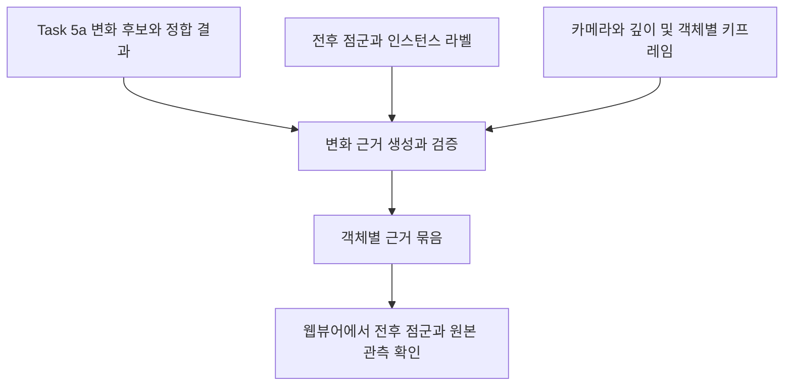

# 3D 변화 근거 생성과 검증 설계

2026년 10월 12일 설계안

전후 3D 점군에서 객체가 어떻게 달라졌는지 추적할 수 있는 근거를 만들고, 원본 관측이 그 판단을 뒷받침하는지 검사한다. 변화 후보마다 전후 객체 점군, 위치 차이, 관측 충분성, 원본 프레임을 묶어 웹뷰어에 제공한다. 근거의 중심은 3D 점군이며, 키프레임은 해당 공간을 실제로 관측한 원본 기록으로 연결한다.

## 파이프라인과 담당 범위



Task 5a가 회차 간 정합과 객체 대응, 변화 후보 생성을 맡는다. 이 모듈은 그 후보의 원본 점을 찾고, 기하 차이를 재계산해 결과의 일관성을 검사하고, 가림과 미관측을 구분해 판단을 뒷받침하는 관측을 연결한다. 기존 후보와 다른 근거가 나오면 불일치를 기록하며 입력 변화 결과를 덮어쓰지 않는다.

Task 5b의 객체별 대표 키프레임은 관측 프레임 후보로 사용한다. 현재 AUTO TOUR 360의 투어 이동 지점 선별은 공간 탐색에 쓰며, 객체별 관측 연결을 대신하지 않는다. 제거된 객체의 현재 위치나 추가된 객체의 이전 위치는 해당 회차에 객체 ID가 없으므로, 그 자리를 관측한 프레임을 별도로 찾는다.

## 입력과 현재 규약

| 입력 | 사용하는 내용 | 요구 수준 |
|---|---|---|
| `changes.json` | 전후 objects 참조, 변화 유형, 객체 ID 쌍, 기준 좌표계 정합 변환 | 필수 |
| 전후 `objects.json` | 객체 ID, 중심과 bbox, instances 참조 | changes에서 추적 |
| 전후 `instances.json` | `point_labels_uri`, 객체와 원본 점의 연결 | 필수 |
| 전후 `reconstruction.json`과 PLY | 원본 XYZRGB, 좌표 단위, 카메라와 깊이 | 점군은 필수, 깊이는 가시성 검사에 필요 |
| 전후 `frames.json`과 원본 영상 | 프레임 ID, 원본 index와 시각, view ID와 회전 | 2D 관측 연결에 필요 |
| 전후 `keyframes.json` | 객체가 잘 보이는 원본 프레임 후보 | 선택 입력이며 없으면 카메라에서 후보 검색 |
| Task 5a의 대응 진단 자료 | 대응 점수, 대안 후보, 모호성, 객체 정합 정보 | 현재 공통 규약 밖의 확장 제안 |

`objects → instances → reconstruction → frames → video` 참조를 따라 입력을 읽는다. [공통 규약](contracts.md)이 정의한 상대 경로, 회차별 ID, 원본 PLY의 `point_index`, 원본 영상 기준 시각을 그대로 사용한다. 독립 재구성한 두 점군의 점 인덱스는 서로의 대응 ID가 아니다.

현재 `changes.evidence`에는 `capture_id`와 `frame_id`만 들어간다. 점 인덱스, 기하 지표, 가시성 상태를 담는 새 근거 형식은 별도 버전으로 설계해야 한다. 기존 `artifact.schema.json`이나 task registry에서 이미 지원하는 형식으로 취급하지 않는다.

현재 Task 5a의 별도 실험은 공통 규약과 호환되지 않으며, 객체 파일 제거 실험에는 다른 마스크와 겹치는 점이 남아 있다. 해당 실험을 사용할 때는 명시적인 입력 변환과 원본 점 역매핑이 필요하고, 파일을 제거했다는 이유로 실제 공간이 비었다고 취급하지 않는다. [실험의 범위와 한계](../src/spacewatch3d/tasks/task_5a_change_detection/README.md)

## 모듈 인터페이스

호출자는 입력 manifest와 출력 폴더, 설정만 전달한다. 내부에서 참조를 해석하고, 필요한 영역의 점과 관측을 읽고, 근거를 생성한다.

```python
def generate_evidence(
    changes_manifest: Path,
    output_dir: Path,
    config: EvidenceConfig,
    before_keyframes: Path | None = None,
    after_keyframes: Path | None = None,
    correspondence_report: Path | None = None,
) -> Path:
    """이번 실행의 evidence.json 경로를 반환한다."""
```

이는 제안 인터페이스이며 아직 구현된 함수나 등록된 task가 아니다. 입력은 읽기 전용으로 사용하고, 새 실행 폴더에 결과를 저장한다. 입력 참조가 손상되면 실행 오류로 보고한다. 정상 입력에서 깊이·대응 근거 등이 부족하면 해당 후보의 근거 부족 상태를 출력한다. 한 후보의 관측 부족이 다른 후보의 근거 생성을 중단시키지는 않는다.

## 처리 절차

### 원본 점과 출처 확보

변화 후보의 `before_instance_id`와 `after_instance_id`를 각 회차의 라벨 CSV에서 찾고, 해당 `point_index`에 대응하는 PLY 점을 가져온다. 분석용 다운샘플링은 원본 점 인덱스 목록으로 역추적할 수 있어야 한다. 객체의 메시가 생성됐어도 검증에는 원본 관측 점군을 사용한다.

필터링된 점이 하나도 없으면 객체가 제거됐다는 근거가 아니라 입력이나 분할 품질의 문제로 기록한다. 주변 공간도 함께 읽어 다른 객체에 가려졌거나 같은 위치에 다른 표면이 있는지 검사한다.

### 기준 좌표계 통일

현재 회차의 원본 점을 `baseline_from_current`로 기준 회차 좌표계에 변환한다. 원본 PLY는 이미 reconstruction 좌표이므로 mesh용 `world_from_object`를 중복 적용하지 않는다. Sim3의 배율도 변환 행렬에 포함된 것을 한 번만 적용한다.

정합 실패나 겹침 부족이면 전후 점군 자료는 제공하되 기하 변화 검증을 보류한다. 단위가 `arbitrary`이면 거리도 기준 reconstruction 단위로 표시하며 미터로 바꾸어 표시하지 않는다. 정합 RMSE는 검사 자료로 기록하지만 모든 위치의 최대 오차를 보장하는 값으로 사용하지 않는다.

### 기하 근거 생성

| 후보 | 생성할 3D 근거 | 보류할 조건 |
|---|---|---|
| 이동 | 전후 객체 점군, 중심 차이 벡터와 크기, 기존 이동량과의 일치 여부, 대응 형상 비교 | 정합 불안정, 비슷한 객체의 모호한 대응, 부분 관측에 의한 중심 변화 |
| 제거 | 이전 객체의 점과 위치, 현재 같은 영역의 전체 장면 점, 현재의 빈 공간 관측 | 가림, 깊이 누락, 촬영 범위 밖, 다른 위치의 동일 객체 대응이 미해결 |
| 추가 | 현재 객체의 점과 위치, 이전 같은 영역의 전체 장면 점, 이전의 빈 공간 관측 | 이전 회차 미관측, 이동 객체를 추가로 잘못 분류했을 가능성 |

이동에서는 정합된 장면 좌표의 중심 차이를 먼저 계산한다. 부분 관측으로 중심이 달라질 수 있으므로 중심 차이 하나만으로 실제 이동을 확정하지 않는다. 대응의 신뢰성과 관측 범위를 함께 기록한다.

형상 비교에는 두 방향 최근접 표면 거리의 분포와 허용 거리 안의 비율을 사용한다. 한 방향의 낮은 거리만으로 작은 조각과 완전한 객체를 같은 형상으로 인정하지 않는다. 표본 밀도와 관측 범위도 함께 기록한다. 최근접 거리 계산 방법은 [Open3D의 점군 거리 문서](https://www.open3d.org/docs/release/python_api/open3d.geometry.PointCloud.html?highlight=voxel_down_sample_and_trace)에 설명돼 있다. 이 지표를 변화 근거로 사용하는 방식과 임계값은 이 설계에서 검증할 선택이다.

객체끼리 국소 정합을 사용한다면 형상 확인을 위한 별도 복사본에만 적용한다. 웹뷰어에 표시할 전후 위치와 이동량은 장면 좌표에서 유지한다. 제공된 객체 ID 쌍은 Task 5a의 주장으로 보관하며, 새 객체 대응을 임의로 배정하지 않는다. 대응 진단이 없으면 동일한 물체라는 검증은 미평가로 표시하고, 반복되는 의자 같은 사례는 수동 확인 또는 진단 보강 대상으로 남긴다.

### 가시성과 빈 공간 검사

제거 후보는 이전 객체의 관측 표면 위치를 현재 회차 카메라에 투영한다. 추가 후보는 현재 객체의 관측 표면 위치를 이전 회차 카메라에 투영한다. bbox의 내부를 모두 실제 물체가 차지했던 공간으로 채우지 않고, 원본 점 또는 그 점이 속한 작은 셀을 질의 위치로 사용한다.

기준 좌표의 질의 점을 해당 회차 reconstruction 좌표로 되돌린 다음, `inverse(world_from_camera)`로 카메라 좌표에 놓는다. 해당 카메라의 보정 이미지와 intrinsics로 투영하고, 질의 점의 z와 같은 화소의 `camera_z` 깊이를 같은 단위로 비교한다. Sim3가 있을 때도 이 회차의 깊이 단위를 그대로 유지하도록 역변환한다.

| 깊이 관측과 질의 점의 관계 | 기록할 상태 |
|---|---|
| 관측 깊이가 질의 점보다 충분히 멂 | 그 위치까지 광선이 지나간 빈 공간 관측 |
| 관측 깊이가 질의 점보다 가까움 | 앞의 표면에 가려진 위치 |
| 오차 범위 안에서 비슷함 | 해당 위치에 표면 관측이 있음. 같은 객체인지는 별도 확인 |
| 영상 밖, 카메라 뒤, 깊이 0 또는 저품질 깊이 | 미관측 또는 사용 불가 |

불확실한 깊이 경계와 외곽 화소는 제외하고, 서로 다른 시점의 관측을 종합한다. 동일 구도의 인접 프레임을 여러 독립 증거로 세지 않는다. 유효 관측이 충돌하면 충돌을 기록하고 보류한다. 이 검사는 불투명 표면과 검증된 카메라·깊이를 가정하며, 투명·반사 표면이나 촬영 중 움직이는 물체에는 별도 품질 검사가 필요하다.

물체가 차지한 공간, 비어 있음을 관측한 공간, 모르는 공간을 구분하는 원칙은 [OctoMap 문서](https://octomap.github.io/octomap/doc/index)에서도 설명한다. 첫 구현은 후보 주변의 점과 깊이를 직접 검사하는 방식으로 시작하고, 장면 전체의 점유 지도 구축은 이후 필요에 따라 확장한다.

분모는 전체 질의 위치 수로 유지한다. 예를 들어 빈 공간 관측 비율은 `빈 공간으로 확인한 위치 수 / 전체 질의 위치 수`로 기록한다. 가려진 위치를 분모에서 빼서 낮은 관측률을 숨기지 않는다. 빈 공간·표면 있음·가림·미관측·충돌의 수와 비율을 따로 저장한다. 깊이 없이 점군만 있는 경우 점의 부재는 기록할 수 있지만 빈 공간 확인 상태는 부여하지 않는다.

### 원본 키프레임 연결

물체가 있는 쪽에서는 Task 5b 후보와 객체의 `evidence_frame_ids`에서 출발한다. 카메라 등록 여부, 실제 가시 표면 비율, 화면 내 크기, 선명도와 시점 중복을 평가해 소수의 원본 관측을 고른다. 예쁜 이미지나 선명한 이미지라는 이유만으로 가시성이 높은 프레임을 밀어내지 않는다.

물체가 없는 쪽에서는 상대 회차의 객체 ID 대신 공통 좌표의 비교 영역을 질의한다. 그 영역의 빈 공간을 실제로 관측한 카메라와 프레임을 선택한다. 적합한 관측이 없으면 전후 두 장을 억지로 채우지 않는다.

360도 영상은 `frame_id`, `source_frame_index`, `timestamp_s`, `view_id`, `source_from_view_rotation`을 함께 유지한다. 검사는 reconstruction의 보정된 view 이미지에서 수행하고, 원본 panorama의 방향은 view 회전을 사용해 계산한다. 뷰어는 해당 원본 시각과 방향을 열어준다. 물체가 없는 쪽에는 객체 마스크 대신 비교 영역의 투영 표시를 사용하며, 생성한 표시·crop은 원본 참조와 구분한다.

### 검증 상태 집계

변화 유형과 근거 상태를 분리한다. `removed`라는 후보에 근거가 부족하다고 해서 원본 유형을 자동으로 다른 유형으로 바꾸지 않는다.

| 제안 상태 | 의미 |
|---|---|
| `supported` | 해당 후보에 요구되는 기하·대응·관측 검사가 확보된 자료에서 뒷받침됨 |
| `insufficient` | 필수 근거가 없거나 품질이 부족해 판단을 보류함 |
| `inconsistent` | 신뢰 가능한 검사 결과가 입력 후보와 불일치함 |

세 상태는 정답 확률이 아니다. 기하 검사, 동일 객체 대응, 관측 충분성, 원본 프레임 연결은 각각 별도 상태로 남긴다. 기하 차이가 뚜렷해도 동일 객체 대응이 미평가이면 이동 후보의 전체 검증은 근거 부족으로 남긴다. 키프레임이 없으면 3D 근거를 보존하되 원본 프레임 연결의 실패를 명시한다. 첫 구현에서 `shape_changed`는 지원 범위 밖으로 기록하며, `unknown`은 기존 보류 이유를 유지한다.

## 출력과 추적 가능성

독립 산출물 `evidence.json`은 자체 형식 버전 `spacewatch3d-change-evidence/0.1`을 갖는 확장안이다. 공통 kind 등록과 CLI 통합은 생산·소비 task가 규약을 합의한 뒤 진행한다.

| 기록 영역 | 필수 내용 |
|---|---|
| 입력 출처 | changes 및 상위 manifest의 상대 경로와 SHA256, scene ID와 회차 ID |
| 후보 참조 | changes 배열의 index와 해당 changes 파일 SHA256 |
| 원본 점 | 각 회차 PLY 참조와 SHA256, 객체 ID, 원본 점 인덱스 파일 |
| 공통 좌표 | 기준 좌표 ID, 정합 변환과 상태, 단위 |
| 기하 근거 | 전후 점 수, 중심 차이, 최근접 거리 분포, 비교 범위, 계산 설정 |
| 관측 근거 | 질의 위치, 검사한 카메라, 가시성 분류와 집계, 깊이 품질·충돌·누락 |
| 프레임 | 원본 회차·frame ID·시각·view, 선택 이유, 표시 영역과 원본 참조 |
| 검증 결과 | 항목별 상태, 전체 상태, 이유 코드, 원본 Task 5a confidence |
| 재현 정보 | 구현 revision, 설정, 사용 입력과 출력 해시, synthetic 전파 |

원본 confidence는 생산자가 제공한 점수로 기록하고 정답 확률로 재해석하지 않는다. 근거 점군의 미리보기는 표시용 샘플이며 원본 점 인덱스 파일이 추적의 기준이다. 경로는 해당 근거 manifest 기준 상대 경로로 저장한다. 거리 단위를 필드와 화면에 함께 표시한다.

## 웹뷰어 연결

변화 목록에서 후보를 선택하면 기준 좌표계의 주변 장면과 전후 객체 점군을 연다. 이전 점군은 주황색, 현재 점군은 파란색으로 표시하고 문자 범례를 함께 제공한다. 이동 후보에는 위치 차이 화살표와 거리 단위를 표시한다. 제거·추가 후보에는 해당 영역을 관측한 카메라 방향과 빈 공간·가림·미관측 구분을 보여준다.

전후 토글 시 뷰어 카메라 위치와 방향을 유지한다. 근거를 읽기 위한 영역 확대는 제공하되 객체 점군끼리 정렬해서 실제 이동을 지우지 않는다. 원본 키프레임은 같은 후보의 관측 자료로 표시하고, 클릭하면 원본 영상의 시각과 방향으로 이동한다.

현재 AUTO TOUR 360은 panorama 탐색 기능을 제공한다. 이 설계의 3D 근거 확인에는 점군을 여는 화면과 근거 manifest를 읽는 연결이 추가로 필요하다. 계산은 오프라인 Python 모듈에서 수행하고 웹뷰어는 결과 표시와 원본 이동을 맡는다. 전체 점군은 회차당 한 번 읽고, 객체 인덱스와 공간 검색 구조를 재사용하며, 깊이는 필요한 후보 프레임만 읽는다. 뷰어에는 표시용 샘플과 필요한 주변 영역만 전달한다.

## 설정과 검증 데이터

설정에는 표본 간격, 최근접 거리 허용치, 깊이 허용 오차, 최소 관측 비율, 독립 관측 수, 프레임 수와 표시용 점 수를 둔다. 길이 설정은 기준 좌표 단위를 명시한다. 고정된 임의의 미터값을 모든 입력에 적용하지 않는다. 정적인 공간의 정합 잔차, 점 간격, 깊이 오차와 객체의 부분 관측 정도를 측정해 설정을 정하고 값을 결과에 남긴다.

| 검증 사례 | 기대 동작 |
|---|---|
| 실제 이동 없이 카메라만 이동 | 정합 후 객체 위치가 유지되며 이동 근거를 만들지 않음 |
| 같은 객체의 알려진 이동 | 전후 점 참조와 기준 좌표 이동량을 재현함 |
| 객체 제거 후 이전 위치가 보임 | 현재 관측이 빈 공간을 뒷받침함 |
| 객체가 다른 물체 뒤에 가려짐 | 제거 확정을 보류하고 가림을 기록함 |
| 해당 구역을 현재 촬영하지 않음 | 미관측으로 보류함 |
| 객체 추가와 이전 빈 공간 관측 | 추가 근거를 구성함 |
| 깊이 누락 또는 저품질 깊이 | 점의 부재와 빈 공간 검증을 구분함 |
| 동일한 의자 여러 개의 모호한 대응 | ID나 클래스만으로 동일 개체를 확정하지 않음 |
| 부분 점군이나 분할의 합침과 나뉨 | 중심 변화·형상 차이를 곧바로 물리 변화로 확정하지 않음 |
| Sim3와 상대 단위 입력 | 변환을 한 번 적용하고 미터 오표기를 방지함 |
| 파일 순서나 점군 샘플링 변경 | 입력 해시와 원본 점 역매핑으로 결과를 추적함 |
| 360도 view 또는 VFR 원본 | 원본 시각과 view 방향을 정확히 연결함 |

합성 데이터는 좌표·참조·알려진 이동·가림 분류 검증에 사용한다. 실제 전후 촬영과 사람의 판단을 포함한 평가에서는 추가·제거·이동별 오탐과 누락, 보류 비율, 사람과의 판단 일치, 선택 프레임의 관측 충분성을 따로 측정한다. 파일 형식 검증이나 합성 객체 파일 제거 성공을 실제 삭제 검증 성능으로 보고하지 않는다.

## 구현 순서

1. **원본 추적과 3D 근거 생성:** 하나의 이동 후보를 입력으로 받아 전후 객체의 원본 점 인덱스, 정합된 위치, 중심 차이, 주변 점군과 출처를 출력한다. 대응 검증이 없는 경우 기하 근거 생성 완료와 후보 전체 검증 보류를 함께 표시한다.
2. **뷰어에서 근거 확인:** 전후 점군의 공통 좌표 표시, 카메라 유지 토글, 이동량과 검증 상태 표시를 연결한다. 첫 단계의 근거를 사람이 확인할 수 있는 완료 지점이다.
3. **가시성과 추가 제거 검증:** 검증된 카메라·깊이를 가진 데이터로 빈 공간·가림·미관측 분류를 구현하고, 원본 추가·제거 후보와 대조한다.
4. **전후 키프레임 연결:** 객체가 있는 쪽과 없는 쪽의 관측을 각각 선택하고 360도 원본 시각·방향 이동을 연결한다.
5. **대응 진단과 공통 규약 통합:** Task 5a와 동일 객체 대응 근거를 연결하고, 근거 형식과 registry·validator 확장을 소비 task와 함께 통합한다.

첫 구현의 완료 기준은 변화 후보 하나에서 해당 원본 점군과 계산 결과를 재현하고, 웹뷰어에서 전후 위치를 확인하며, 검증하지 못한 항목을 근거 부족으로 구분하는 것이다. 이후 깊이·카메라와 대응 진단이 준비된 범위부터 전체 검증 상태를 확장한다.
