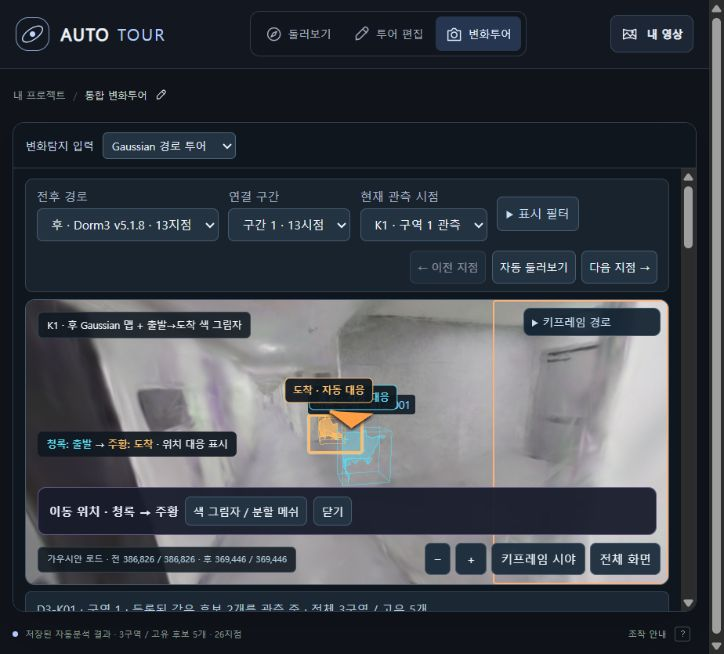

# 통합 변화투어 검증 · 2026-10-27

Auto Tour 360의 상단 **변화투어**와 `?mode=changes`가 기존 Gaussian 경로 투어를 같은 앱의 뷰포트에서 연다. main의 기존 일반 투어·편집 기능을 유지하며 기존 Dorm 메쉬·사진과 Rescan도 입력 선택으로 제공한다.

## 연결한 자료

| 촬영 | 원본 경로 | 지점 | 연결 | 분리 구간 |
| --- | --- | ---: | ---: | ---: |
| 전 Dorm2 | v5.1.7 | 13 | 9 | 4 |
| 후 Dorm3 | v5.1.8 | 13 | 12 | 1 |

원본 26개 포즈와 연결성을 유지한다. 전후 맵을 각 포즈에서 렌더링한 52개 RGB를 포함하며, 깊이로 검증한 가림 판정은 저장된 후보 자료를 재사용한다. 구간 사이의 보행 경로를 새로 만들지 않는다.

사람을 제외한 기존 Gaussian RGB SimSaC 결과는 3구역·고유 후보 5개·관측 링크 18개다. 후보 ID와 3D 범위는 원본 결과와 같으며 키프레임마다 새 이벤트로 세지 않는다. 이동 후보의 색 그림자는 기존 영상 인스턴스·분할 메쉬의 자동 대응 결과다.

공개 파일은 `apps/autotour360/assets/gaussian-change/`에 있다. `runtime-manifest.json`은 번들 파일의 크기와 SHA-256을 기록한다. PLY는 Git에서 제외하며 맵 메타데이터의 파일명·해시와 같은 입력을 별도로 연결한다. 실행 방법은 앱 README에 있다.

## 검증

- 앱 Node 테스트 80개 통과. 소스 선택, 같은 출처의 프레임 메시지, 경로별 맵 선택, 단절 구간 이동을 확인했다.
- 앱 Python 테스트 27개 중 24개 통과·3개 환경 조건으로 건너뜀. 공개 파일의 SHA-256, 원본 렌더·후보 보존, HTTP 범위 요청, 경로 탈출·비공개 입력 차단을 확인했다.
- 기존 루트 테스트 19개와 7개 작업의 fixture 계약 확인을 통과했다.
- 실제 브라우저에서 기본 자료 위치로 전 386,826·후 369,446 Gaussians를 로드했다. 후 경로 선택 시 Dorm3 맵으로 전환하고 R12 후보의 출발·도착 색 그림자가 표시된다. 일반 둘러보기에서 변화투어로 복귀할 때 상태를 보존하며 브라우저 콘솔 오류가 없다.

## 적용 범위

저장된 분석 결과를 투어에 연결하는 기능이다. 이동 중 새 추론·정합을 실행하지 않는다. 적용된 정합은 기존 전역·구역별 메쉬 변환과 잔차 보정을 Gaussian 맵에 전달한 것이며 Gaussian 전용 정합 정확도를 새로 측정한 것은 아니다. Dorm2·Dorm3는 서로 다른 층의 파일럿으로 시간 변화의 정답 데이터가 아니다. 새 촬영 쌍의 분석·렌더 생성 자동화는 이번 통합에 포함하지 않는다.
